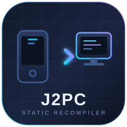
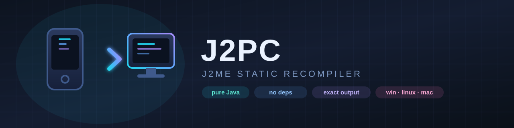

<h1 align="center">
  
  <br/>
  J2PC
</h1>

<p align="center">
  <b>J2ME → Java static recompiler</b><br/>
  Turns a J2ME/MIDP application into plain Java source that compiles and runs on a desktop JDK.
</p>

<p align="center">
  
</p>

<p align="center">
  
  
  
  
</p>

---

**J2ME → Java static recompiler.** Turns a J2ME/MIDP application (`*.jar` + `*.jad`) into
plain Java source that compiles and runs on a desktop JDK, on Windows, Linux and macOS.

J2PC is not a decompiler: it does not try to recover the original code. It translates
bytecode into equivalent Java, so obfuscated, hand-written or otherwise "weird" bytecode
survives the trip unchanged.

```
   game.jar ──┐
              ├──► class parser ──► bytecode decoder ──► data-flow analysis
   game.jad ──┘                                              │
                                                             ▼
                        generated Java sources ◄── source emitter
                                                             │
                                              MIDP emulation layer + launcher
                                                             │
                                                             ▼
                                                    runs on a desktop JVM
```

## Status

| Area | State |
|------|-------|
| Class file parsing (up to Java 21) | done |
| Bytecode decoding (all opcodes) | done |
| Typed data-flow analysis (stack + locals) | done |
| Java source emission (dispatch-loop recompiler) | done |
| `invokedynamic` (string concat, lambdas, method refs) | done |
| Enums, interfaces with constants, inner/anonymous classes | done |
| MIDP 2.0 emulation (`lcdui`, `lcdui.game`, `rms`, `io`, `media`) | partial, enough for 2D games |
| Nokia UI API (`FullCanvas`, `DirectGraphics`, `DeviceControl`) | partial |
| Bluetooth (`javax.bluetooth`) | stubs: the API compiles, there is no radio |
| Launcher + asset loading | done |
| CLI | done |
| TUI (terminal interface) | done |
| GUI (local web UI) | done |
| JAR packaging (`--build`) | done |
| Native launcher (`--exe`, jpackage) | done |

### Corpus results

Measured on a private collection of **151 real J2ME applications**:

| Metric | Value |
|--------|-------|
| Recompiled without errors | **151 / 151** |
| Generated Java compiles | **124 / 151** |
| Classes emitted for those | 3 275 |
| Methods emitted for those | 82 293 |

Two features make that possible beyond the translation itself:

* **Missing types are stubbed.** A suite built against a 3D engine it never packages
  still translates; J2PC emits a signature-compatible stand-in for every type the
  application references but does not ship, derived from the references themselves.
* **Missing members are stubbed too.** Old packagers occasionally drop a member record
  while the reference survives; that member is re-declared on the class.

The gap between the two numbers is dominated by three causes, in order:

1. **Missing platform APIs** — `javax.microedition.m3g` (3D), `com.mascotcapsule.micro3d.v3`
   (3D), `javax.microedition.pim`, `javax.wireless.messaging`. Twelve applications need a 3D
   engine alone.
2. **Vendor extensions** — `com.nokia`, `com.siemens`, `com.motorola` variants beyond the
   implemented subset.
3. **Type fidelity in obfuscated code** — a slot reused for unrelated types can leave the
   emitter with an `Object` where a specific array or interface is required.

Every one of those is a missing feature, not a wrong translation: the recompiler never
produces code that silently behaves differently, and `tools/verify.sh` checks exactly that on
the synthetic suite.

Verified end to end — recompiled, compiled **and played**:

* **2048** — full gameplay: rendering, tile movement, merging, scoring
* **Tetris** — rendering, keyboard input, falling pieces, next-piece preview

## Requirements

* JDK 17 or newer (tested with 21). No Maven, no Gradle, no network access.

## Build

```bash
# Windows
build.cmd

# Linux / macOS
./build.sh
```

Result: `dist/j2pc.jar`.

## Usage

```bash
java -jar dist/j2pc.jar [options] <application.jar> [application.jad]
```

| Option | Meaning |
|--------|---------|
| `-o, --out <dir>` | output directory (default `out`) |
| `-v, --verbose` | verbose logging |
| `-q, --quiet` | warnings and errors only |
| `--stats` | machine readable summary on stdout |
| `--no-comments` | drop the per-instruction comments |
| `--no-lines` | drop the `// line N` comments |
| `--package <p>` | force every generated class into package `p` |
| `--only <prefix>` | recompile only classes with this internal name prefix |
| `--indent <str>` | indentation unit (`\t` for a tab) |
| `--list <jar>` | list archive entries and exit |
| `--build` | compile the generated sources and package a runnable JAR |
| `--exe, --native` | also wrap that JAR into a native launcher with `jpackage` |
| `--tui` | start the terminal interface |
| `--gui` | start the desktop interface (local web UI) |
| `-h, --help` | usage |
| `-V, --version` | version |

### Example

```bash
java -jar dist/j2pc.jar -o build/out-2048 "samples/2048.jar"

# the tool writes
#   build/out-2048/game2048/*.java
#   build/out-2048/assets/**            original resources
#   build/out-2048/J2PCLauncher.java    desktop entry point
#   build/out-2048/j2pc-report.txt      per class summary

javac -cp dist/j2pc.jar -d build/gen-2048 build/out-2048/**/*.java
java -cp "dist/j2pc.jar;build/gen-2048" J2PCLauncher
```

## Packaging

`--build` closes the loop: it compiles the generated sources with the JDK's own
compiler, copies in the emulation runtime, and writes a self-contained JAR.

```bash
java -jar dist/j2pc.jar --build -o build/out-Tetris samples/Tetris.jar
# [info] compiled 3 class file(s)
# [info] collected 138 runtime class file(s)
# [info] packaged build/out-Tetris/Tetris.jar (142 entries)

java -jar build/out-Tetris/Tetris.jar      # runs with nothing else on the class path
```

The archive holds the application classes, the `javax.microedition.*` and
`com.nokia.*` runtime, `j2pc.rt.*`, and the original resources under `assets/`.
The manifest points at `J2PCLauncher`, so a double click works as well.

`--exe` (or `--native`) goes one step further and wraps the JAR into a native
launcher with `jpackage` — an app image that needs no Java installation on the
target machine:

```bash
java -jar dist/j2pc.jar --exe -o build/out-Tetris samples/Tetris.jar
# build/out-Tetris/image/Tetris/Tetris.exe
```

`jpackage` ships with the JDK, not the JRE; when it is missing the tool says so
and still leaves you a working JAR.

## Interfaces

Three front ends, one engine.

**CLI** — the default, scriptable, used by the corpus harness and CI.

**TUI** — `--tui`. Line-oriented, so it works in any terminal, over SSH, and in
an IDE console: pick a folder, pick an application, toggle the options, watch the
log. Colour is dropped automatically when the output is redirected or
`NO_COLOR` is set.

**GUI** — `--gui`. A local HTTP server on the loopback interface plus a browser
front end: application list, options, live log, a viewer for the generated
sources, and a *Play* button that starts the packaged application in its own
process. The server binds to `127.0.0.1` only and never leaves the machine. A
plain JDK cannot render a modern page inside a Java window — `JEditorPane` has no
JavaScript and JavaFX is no longer part of the JDK — so the page opens in the
system browser next to a small control window that keeps the server alive. The
front end is plain HTML/JS with no build step, so a WebView could host it later
without touching the server.

Both interactive front ends give every application its own output folder
(`out/Tetris/`, `out/2048/`): suites routinely ship a class with the same name,
and one directory per application keeps them from overwriting each other.

## How the translation works

### 1. Class parsing

`j2pc.classfile` reads the constant pool, members, `Code` attributes, the exception table
and the debug tables (`LineNumberTable`, `LocalVariableTable`) directly from the class
file.

### 2. Bytecode decoding

`j2pc.bytecode.Decoder` turns the raw byte array into instructions with absolute branch
targets. Switch padding and the `wide` prefix are handled; `invokeinterface` and
`invokedynamic` are read with their real four-byte width.

### 3. Data-flow analysis

`j2pc.analyze.Analyzer` runs an abstract interpretation over the operand stack. For every
reachable program point it computes the merged local-variable and stack types. This is what
lets the emitted Java be typed (`int`, `long`, `java.lang.String[]`) instead of a soup of
`Object`.

Locals that different code paths use with different types are split into separate Java
variables, which is exactly what obfuscators force on you.

### 4. Source emission

`j2pc.emit.MethodEmitter` walks the instructions and writes Java.

* **Dispatch mode** (default). Every basic block becomes a `case` of a `switch (__pc)` loop.
  Control flow is therefore preserved literally — no guessing, no restructuring, no
  "cannot decompile this loop" dead ends.
* **Flat mode**. A method without branches and without exception handlers is emitted as
  straight-line Java.

Exception handlers become `try`/`catch` blocks that re-check the caught type and continue
the dispatch loop at the handler address, matching the JVM's exception table semantics.

Because bytecode knows nothing about checked exceptions, every generated body is wrapped so
that an unexpected checked exception is rethrown unchanged instead of being wrapped in a
`RuntimeException`.

### 5. Runtime support

`j2pc.rt` holds the few helpers the generated code needs:

* `Cmp` — `lcmp`/`fcmpg`/`fcmpl`/`dcmpg`/`dcmpl` with correct NaN behaviour,
* `Monitor` — identity-based reentrant locks backing `monitorenter`/`monitorexit`,
* `Sneaky` — rethrows checked exceptions without wrapping,
* `Box` — boxing bridge for slots the analysis could not pin down,
* `Assets` — resource lookup for recompiled suites,
* `Arrays` — reflective `arraylength` fallback.

## MIDP emulation

`src/javax/microedition/**` implements the parts of the J2ME platform that games actually
use, on top of AWT/Swing:

| Package | Contents |
|---------|----------|
| `midlet` | `MIDlet`, `MIDletStateChangeException`, desktop host |
| `lcdui` | `Display`, `Canvas`, `GameCanvas`, `Graphics`, `Image`, `Font`, `Form`, `List`, `Alert`, `TextBox`, `ChoiceGroup`, `Gauge`, `DateField`, `Spacer`, `CustomItem`, `Command` |
| `lcdui.game` | `Layer`, `Sprite`, `TiledLayer`, `LayerManager` |
| `rms` | `RecordStore` and friends, persisted under `~/.j2pc/rms` |
| `io` | `Connector` (`http`, `https`, `file`), `HttpConnection` |
| `media` | `Manager`, `Player`, tone playback via `javax.sound` |

`Graphics` follows MIDP coordinate rules (translate/clip are cumulative, anchors are honoured),
so games draw the way they did on a handset.

## Tests

```bash
# self test: builds a synthetic MIDlet suite, recompiles it, compiles the result
tools/selftest.sh          # or tools\selftest.cmd on Windows

# behavioural equivalence: runs the original and the recompiled classes and diffs them
tools/verify.sh            # or tools\verify.cmd

# sample corpus: every JAR in samples/
test.sh                    # or test.cmd
```

The self test needs no third-party files: `src/test` contains a synthetic MIDlet suite that
exercises every opcode family, `invokedynamic`, enums, inner classes and exception handlers.

`tools/verify.sh` is the important one. It calls `j2pc.tools.Verifier` against the original
classes and against the recompiled ones and compares the output, so a translation that compiles
but behaves differently is caught.

For the full corpus there is a batch runner:

```powershell
powershell -File tools/batch.ps1 -Compile          # recompile + compile every JAR in the folder
powershell -File tools/errors.ps1                  # group the failures by cause
```

## Project layout

```
src/j2pc/
  classfile/     class file model, constant pool, descriptors
  bytecode/      opcodes, instruction model, decoder
  analyze/       slot types, frames, abstract interpretation
  emit/          names, modifiers, method and class emitters
  rt/            runtime support for generated code
  jar/           JAR and JAD readers
  build/         source compiler, JAR packager, jpackage wrapper
  tui/           terminal interface
  gui/           local HTTP server and web front end
  tools/         disassembler and analysis tracing helpers
  Main.java      CLI entry point
  Recompiler.java orchestration
src/javax/microedition/   MIDP emulation
src/com/nokia/            Nokia UI API emulation (FullCanvas, DirectGraphics)
src/test/synthetic/       synthetic MIDlet suite used by the self test
docs/                     architecture, design notes, roadmap
samples/                  small JARs used by the corpus runner
tools/                    batch runner, self test, verifier, error taxonomy
```

## Documentation

* [docs/architecture.md](docs/architecture.md) — how the pipeline fits together
* [docs/bytecode-to-java.md](docs/bytecode-to-java.md) — translation rules, opcode by opcode
* [docs/limitations.md](docs/limitations.md) — what does not work yet
* [docs/deobfuscation.md](docs/deobfuscation.md) — detection and structural rewrites
* [docs/packaging.md](docs/packaging.md) — JAR and native image output
* [docs/ci.md](docs/ci.md) — workflows, artifacts, how to reproduce CI locally
* [docs/roadmap.md](docs/roadmap.md) — further work
* [docs/building.md](docs/building.md) — build and test details

## License

MIT. See [LICENSE](LICENSE).
